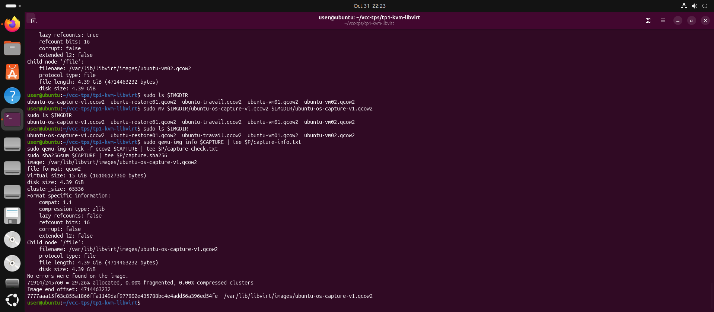
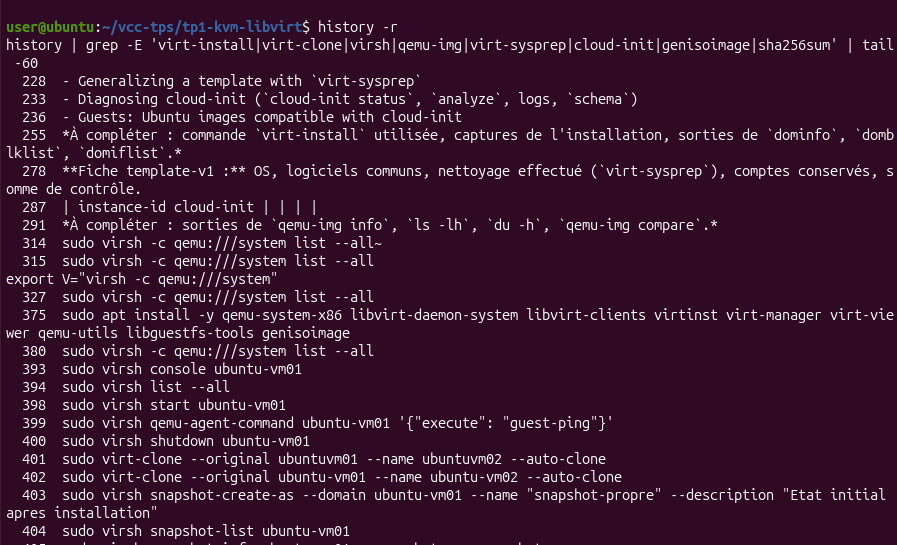
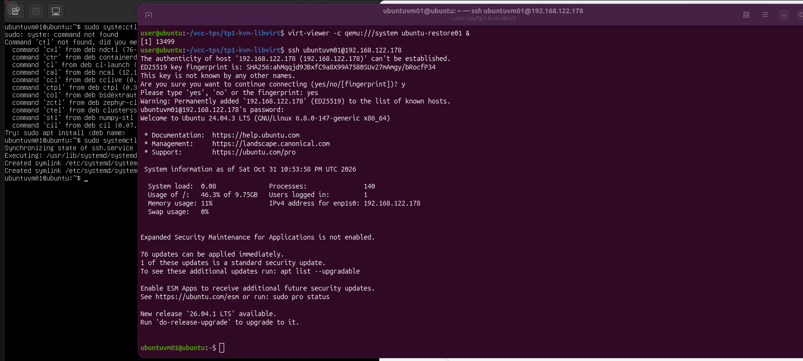
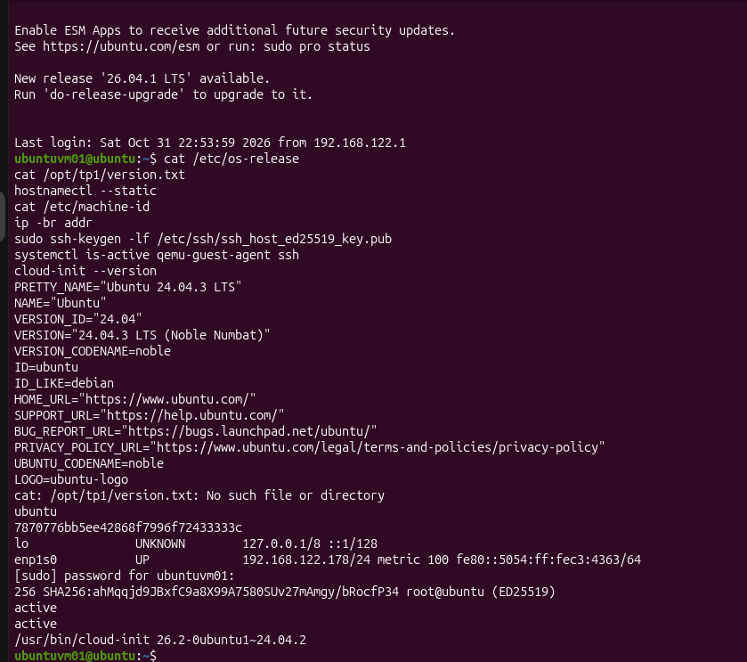
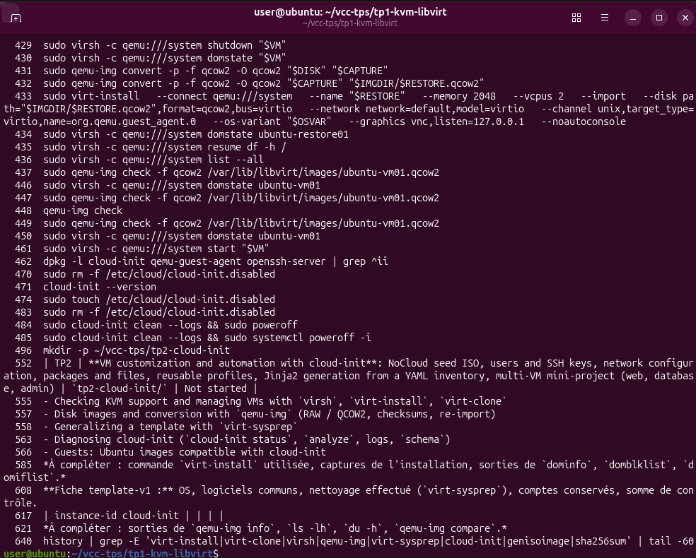
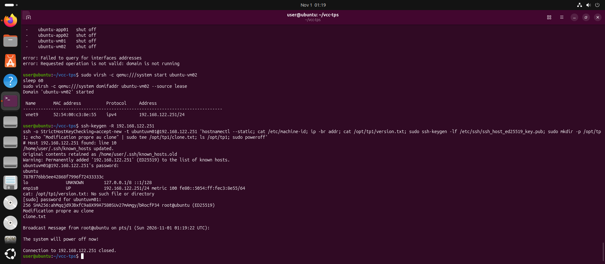

# TP1 : Virtualisation avec KVM/QEMU et libvirt

**Module :** Virtualisation et Cloud Computing, Master BD2C, FSAC, 2026/2027
**Étudiante :** Salwa Naciri
**Parcours choisi :** Ubuntu 24.04

## 1. Poste hôte et parcours choisi

*À compléter : Ubuntu dans VMware Workstation, RAM, espace disque, virtualisation imbriquée activée.*

## 2. Diagnostic KVM/libvirt (Partie A)

*À compléter : résultat de `lscpu`, `grep -Eoc '(vmx|svm)' /proc/cpuinfo`, `lsmod | grep kvm`, `ls -l /dev/kvm`.*

- Signification de `vmx` / `svm` : ...
- Validation A (libvirt répond, outils présents) : ...

## 3. Création et administration de la VM (Partie B)

*À compléter : commande `virt-install` utilisée, captures de l'installation, sorties de `dominfo`, `domblklist`, `domiflist`.*

**Réponses aux questions :**

1. Différence entre `shutdown` et `destroy` : ...
2. Pourquoi `destroy` ne supprime pas le disque : ...
3. Ce que supprime `undefine` : ...
4. Rôle des pilotes VirtIO : ...
5. Pourquoi le XML seul ne suffit pas : ...

## 4. Clone complet et identités (Partie C)

| Élément | Source | Clone | Identique ou différent ? | Interprétation |
|---------|--------|-------|--------------------------|----------------|
| Nom de la VM dans libvirt | | | | |
| UUID libvirt | | | | |
| Adresse MAC | | | | |
| Adresse IP | | | | |
| Nom d'hôte | | | | |
| machine-id | | | | |
| Empreinte SSH hôte | | | | |
| /opt/tp1/version.txt | | | | |

**Test d'indépendance des disques :** ...

**Limite :** les valeurs internes de vm02 (nom d'hôte, machine-id, empreinte SSH) n'ont pas été relevées, faute de temps et à cause d'un conflit DHCP (voir section 10). Le clone étant une copie du disque de vm01, on s'attend à retrouver les mêmes valeurs que la source (nom d'hôte ubuntu, machine-id 7870776b..., même empreinte SSH). Cela n'a pas été observé sur vm02. Ce que l'on a mesuré : UUID et MAC différents, disque sans backing file. Le même phénomène d'identités copiées a été observé sur ubuntu-restore02, copie de vm01 (machine-id et empreinte SSH identiques à la source).

## 5. Image d'OS et réimportation (Partie D)

**Fiche d'image :** distribution, version, architecture, format, capacité virtuelle, somme de contrôle, statut (capture non généralisée), procédure de réimportation.

**Preuve de réimportation :** ...

## 6. Template généralisé (Partie E)

**Fiche template-v1 :**

| Champ | Valeur |
|-------|--------|
| Fichier | ubuntu-template-v1.qcow2 |
| OS | Ubuntu 24.04.3 LTS, x86_64 |
| Date | 2026-11-01 |
| Format / capacité virtuelle | qcow2, 15 GiB (4.69 GiB occupés) |
| Firmware et matériel | BIOS, disque et réseau VirtIO, réseau NAT default |
| Logiciels communs | openssh-server, qemu-guest-agent, cloud-init 26.2 |
| Nettoyage (virt-sysprep) | machine-id, ssh-hostkeys, udev-persistent-net, logfiles, tmp-files, bash-history |
| Compte conservé | ubuntuvm01 (accès console, laboratoire uniquement) |
| Personnalisation au 1er démarrage | cloud-init NoCloud (seed ISO cidata) |
| SHA256 | 0a4ec9345261c3f436fbe81e66f139a22e4f24daed97894916df68c73a14dc98 |
| Statut | Généralisé, non modifié après création |

## 7. Déploiement de app01 et app02 (Partie F)

| Vérification | app01 | app02 | Résultat |
|--------------|-------|-------|----------|
| Nom libvirt et UUID | | | |
| Adresse MAC | | | |
| Nom d'hôte | | | |
| machine-id | | | |
| Empreinte SSH hôte | | | |
| instance-id cloud-init | | | |
| /etc/tp-instance | | | |
| /opt/tp1/version.txt | | | |

## 8. Formats RAW et QCOW2 (Partie G)

*À compléter : sorties de `qemu-img info`, `ls -lh`, `du -h`, `qemu-img compare`.*

## 9. Études de cas (Partie H)

| Cas | Choix | Justification | Risque | Vérification |
|-----|-------|---------------|--------|--------------|
| 1 | | | | |
| 2 | | | | |
| 3 | | | | |
| 4 | | | | |
| 5 | | | | |
| 6 | | | | |
| 7 | | | | |
| 8 | | | | |

## 10. Difficultés rencontrées

| Problème | Diagnostic | Solution |
|----------|------------|----------|
| | | |

## 11. Conclusion personnelle

Je choisis un clone quand... un template quand... une image quand...

