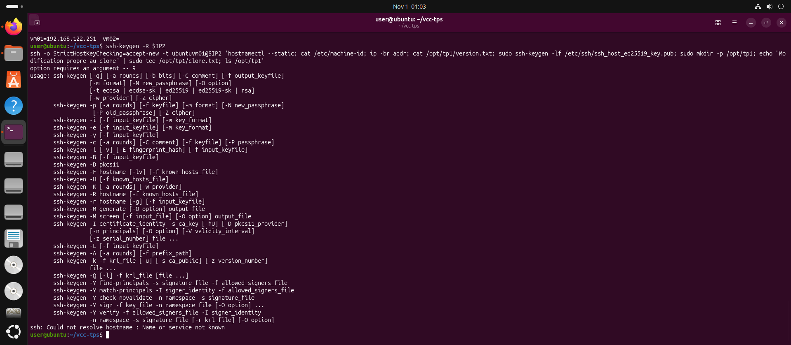
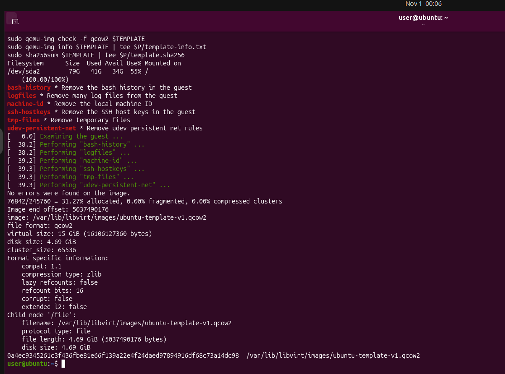
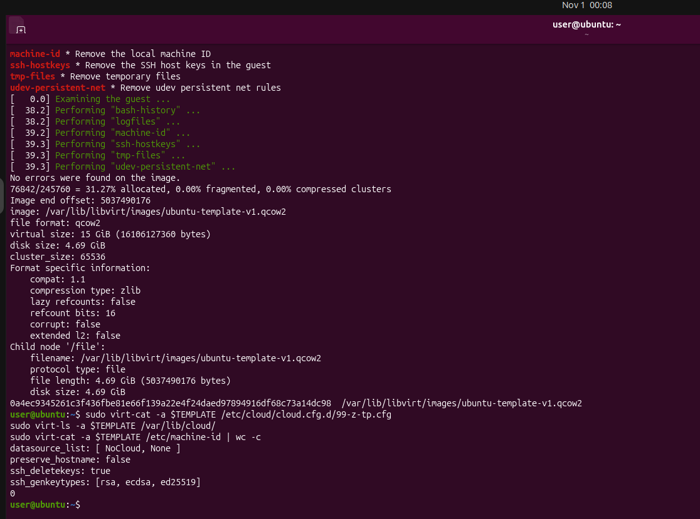
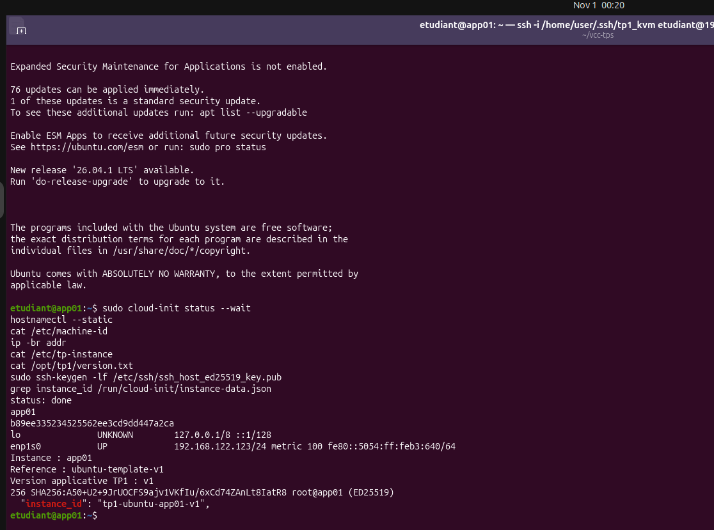
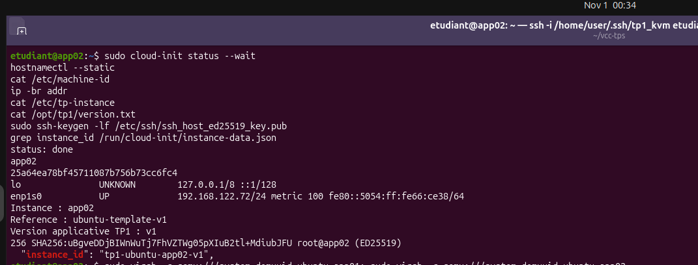
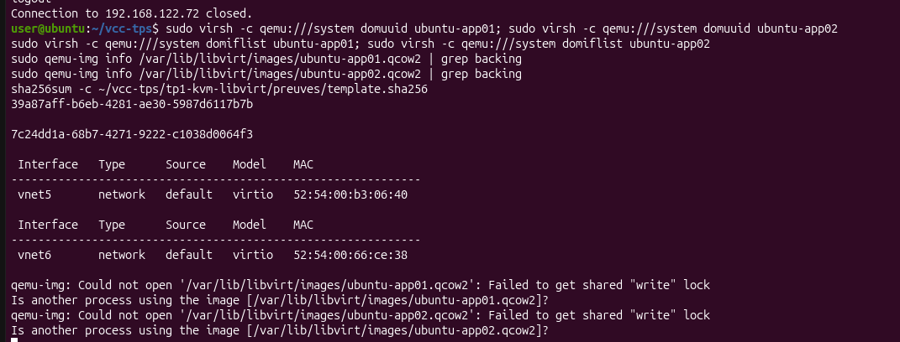

# TP1 : Virtualisation avec KVM/QEMU et libvirt

**Module :** Virtualisation et Cloud Computing, Master BD2C, FSAC, 2026/2027
**Étudiante :** Salwa Naciri
**Parcours choisi :** Ubuntu 24.04

## 1. Poste hôte et parcours choisi

Ubuntu 24.04 installé dans VMware Workstation, virtualisation imbriquée activée. Processeur : Intel(R) Core(TM) i5-8265U CPU @ 1.60GHz. RAM : 7.2Gi. Réseau libvirt : NAT `default`. Parcours Ubuntu 24.04 uniquement.

## 2. Diagnostic KVM/libvirt (Partie A)

- Compteur `vmx|svm` dans `/proc/cpuinfo` : 8 (extensions Intel VT-x / AMD-V exposées à l'OS ; cela ne suffit pas seul à valider KVM).
- `virsh -c qemu:///system list --all` répond, et `virt-install`, `virt-clone`, `qemu-img`, `virt-sysprep`, `genisoimage` sont installés.
- Validation A : libvirt répond et les outils sont disponibles.

## 3. Création et administration de la VM (Partie B)

VM `ubuntu-vm01` : 2 vCPU, 2048 Mio de RAM, disque qcow2 VirtIO de 15 Gio, réseau NAT `default` en VirtIO, firmware BIOS, créée avec `virt-install` depuis l'ISO Ubuntu 24.04 Server. L'ISO a été supprimée ensuite pour libérer de l'espace : il n'existe donc pas de capture de l'installateur. La VM est prouvée par les sorties `virsh` conservées dans `preuves/`.

**Réponses aux questions :**

1. `shutdown` demande un arrêt propre à l'invité (ACPI) ; `destroy` coupe l'exécution brutalement, comme un débranchement.
2. `destroy` arrête seulement la VM : sa définition et ses disques restent intacts.
3. `undefine` supprime la définition libvirt (le XML) mais conserve normalement les disques, sauf avec `--remove-all-storage`.
4. Les pilotes VirtIO sont paravirtualisés : l'invité sait qu'il est virtualisé et dialogue directement avec l'hyperviseur, d'où de meilleures performances disque et réseau.
5. Le XML décrit le matériel virtuel, pas le contenu des disques ni la NVRAM ou le TPM éventuels.

## 4. Clone complet et identités (Partie C)

Clone créé avec `virt-clone` depuis `ubuntu-vm01` arrêtée. Le disque du clone n'a aucun backing file : c'est un clone complet (15 GiB virtuels, 4.39 GiB occupés).

| Élément | Source (vm01) | Clone (vm02) | Identique ou différent ? | Interprétation |
|---------|---------------|--------------|--------------------------|----------------|
| Nom libvirt | ubuntu-vm01 | ubuntu-vm02 | Différent | Gestion de la VM |
| UUID libvirt | 7870776b-b5ee-4286-8f79-96f72433333c | db13bd5a-cf63-47ed-bd15-55ee93436d1c | Différent | Renouvelé par virt-clone |
| Adresse MAC | 52:54:00:71:4f:fd | 52:54:00:c3:8e:55 | Différent | Renouvelée par virt-clone |
| Adresse IP | 192.168.122.178 | non relevée | Dépend du DHCP | Voir section 10 |
| Nom d'hôte | ubuntu | non relevé | Non vérifié | Identité interne de l'OS |
| machine-id | 7870776bb5ee42868f7996f72433333c | non relevé | Non vérifié | Identité du système invité |
| Empreinte SSH hôte | SHA256:ahMqqjd9JBxfC9a8X99A7580SUv27mAmgy/bRocfP34 | non relevée | Non vérifiée | Identité cryptographique du serveur |
| /opt/tp1/version.txt | présent (v1) | absent attendu | Non vérifié | Le clone date d'avant la création du fichier témoin |

**Test d'indépendance des disques :** non réalisé (`clone.txt` n'a pas été créé dans vm02). L'indépendance est établie par `qemu-img info` (aucun backing file sur le disque du clone) et confirmée par app01 et app02, déployés depuis le template.

**Limite :** les valeurs internes de vm02 (nom d'hôte, machine-id, empreinte SSH) n'ont pas été relevées, à cause d'un conflit DHCP (section 10). Le clone étant une copie du disque de vm01, on s'attend à retrouver les mêmes valeurs que la source, mais cela n'a pas été observé sur vm02. Ce qui a été mesuré : UUID et MAC différents, disque sans backing file. Le même phénomène d'identités copiées a été observé sur `ubuntu-restore02`, copie de vm01 (machine-id et empreinte SSH identiques à la source). L'UUID libvirt de vm01 est d'ailleurs la même chaîne que son machine-id : systemd l'a initialisé à partir de l'UUID de la VM au premier démarrage, et le clone copie ce fichier.

**Explications :**

- Un clone peut avoir une nouvelle MAC et garder le machine-id car `virt-clone` modifie les identifiants matériels virtuels, pas les fichiers du système invité.
- Des clés SSH hôte dupliquées permettent d'usurper un serveur et rendent les empreintes ambiguës.
- Un clone de production doit être isolé avant démarrage pour éviter les conflits d'identité et d'adresse et la manipulation de données sensibles.
- Un clone complet n'est pas un template : il n'est ni généralisé ni prévu pour une personnalisation au premier démarrage.

## 5. Image d'OS et réimportation (Partie D)

**Fiche d'image (`ubuntu-os-capture-v2.qcow2`) :** Ubuntu 24.04.3 LTS, x86_64, qcow2, 15 GiB virtuels, BIOS, disque et réseau VirtIO, statut : capture non généralisée, SHA256 : 171cbed929524d682a85809b10f748fa2818df7d809cd1cfc005b77c258d1206.
Procédure : arrêt de vm01, `qemu-img convert` vers un nouveau fichier, `qemu-img check`, `sha256sum`, copie de travail, puis `virt-install --import`.

**Preuve de réimportation :** la VM `ubuntu-restore02` démarre sans installation interactive et affiche `Version applicative TP1 : v1`. Son machine-id (7870776b...333c) et son empreinte SSH sont identiques à ceux de vm01, ce qui est normal pour une image non généralisée.

**Première capture (v1) :** la capture v1 de vm01 ne contenait pas `/opt/tp1/version.txt`, car elle précédait la création du fichier témoin. Elle a donc été refaite en v2, depuis vm01 à jour, puis réimportée avec succès.

## 6. Template généralisé (Partie E)

**Fiche template-v1 :**

| Champ | Valeur |
|-------|--------|
| Fichier | ubuntu-template-v1.qcow2 |
| OS | Ubuntu 24.04.3 LTS, x86_64 |
| Date | 2026-11-01 |
| Format / capacité virtuelle | qcow2, 15 GiB (4.69 GiB occupés) |
| Firmware et matériel | BIOS, disque et réseau VirtIO, réseau NAT default |
| Logiciels communs | openssh-server, qemu-guest-agent, cloud-init 26.2 |
| Nettoyage (virt-sysprep) | machine-id, ssh-hostkeys, udev-persistent-net, logfiles, tmp-files, bash-history |
| Compte conservé | ubuntuvm01 (accès console, laboratoire uniquement) |
| Personnalisation au 1er démarrage | cloud-init NoCloud (seed ISO cidata) |
| SHA256 | 0a4ec9345261c3f436fbe81e66f139a22e4f24daed97894916df68c73a14dc98 |
| Tests de déploiement | app01 et app02 : identités distinctes, template inchangé (`sha256sum -c` : OK) |

Le nettoyage ne remplace pas un audit : le template reste un artefact de laboratoire.

## 7. Déploiement de app01 et app02 (Partie F)

| Vérification | app01 | app02 | Résultat |
|--------------|-------|-------|----------|
| Nom libvirt et UUID | ubuntu-app01 / 39a87aff-b6eb-4281-ae30-5987d6117b7b | ubuntu-app02 / 7c24dd1a-68b7-4271-9222-c1038d0064f3 | Différents |
| Disque système | ubuntu-app01.qcow2, sans backing file | ubuntu-app02.qcow2, sans backing file | Distincts |
| Adresse MAC | 52:54:00:b3:06:40 | 52:54:00:66:ce:38 | Différentes |
| Réseau | 192.168.122.123 | 192.168.122.72 | Pas de conflit en fonctionnement simultané |
| Nom d'hôte | app01 | app02 | Conforme |
| machine-id | b89ee335234525562ee3cd9dd447a2ca | 25a64ea78bf45711087b756b73cc6fc4 | Différents, non vides |
| Empreinte SSH hôte | SHA256:A50+U2+9JrUOCFS9ajv1VKfIu/6xCd74ZAnLt8IatR8 | SHA256:uBgveDDjBIWnWuTj7FhVZTWg05pXIuB2tl+MdiubJFU | Différentes |
| instance-id cloud-init | tp1-ubuntu-app01-v1 | tp1-ubuntu-app02-v1 | Distincts |
| /etc/tp-instance | Instance : app01 | Instance : app02 | Personnalisé |
| /opt/tp1/version.txt | Version applicative TP1 : v1 | Version applicative TP1 : v1 | Commun conservé |

`cloud-init status` : `done` sur les deux instances. Le template n'a pas été modifié : `sha256sum -c` affiche `OK`.

## 8. Formats RAW et QCOW2 (Partie G)

Sorties complètes dans `preuves/formats.txt`.

| Fichier | Taille virtuelle | Taille apparente (ls) | Occupation réelle (du) |
|---------|------------------|-----------------------|------------------------|
| disque-raw.img | 5 GiB | 5.0G | 4.0K |
| disque-qcow2.qcow2 | 5 GiB | 193K | 196K |
| disque-converti.qcow2 | 5 GiB | 193K | 196K |

`qemu-img compare` : « Images are identical ».

1. Un RAW de 5 Gio peut occuper bien moins : c'est un fichier sparse, les blocs jamais écrits ne sont pas alloués.
2. « RAW occupe toujours toute sa capacité » est faux : cela dépend de la création et du système de fichiers.
3. QCOW2 est un format de conteneur : il n'implique pas qu'un OS soit installé.
4. Convertir ne généralise pas : machine-id et clés SSH sont copiés tels quels.
5. Un template peut être en RAW : un template est un rôle, pas un format ; QCOW2 apporte en plus snapshots et backing files.
6. La conversion d'un disque système se fait hors ligne : la VM écrit en continu, et `qemu-img` refuse d'ouvrir un disque verrouillé.

## 9. Études de cas (Partie H)

| Cas | Choix | Justification | Risque | Vérification |
|-----|-------|---------------|--------|--------------|
| 1 | Clone complet, en environnement isolé | Copie indépendante, production intacte | Identités dupliquées, conflit réseau | Comparer hostname, machine-id, clés SSH |
| 2 | Template généralisé + cloud-init | Base commune, personnalisation par instance | Template mal nettoyé | Identités uniques sur chaque instance |
| 3 | Image disque + XML de la VM | Capture le système installé | Capture incohérente, configuration manquante | Réimporter et démarrer la VM |
| 4 | Installer depuis une ISO ou une image d'OS | Un disque vide n'est pas amorçable | Confondre disque vide et image d'OS | Démarrage sur le disque |
| 5 | Template ou image généralisée, documentée, versionnée | Référence commune et traçable | Comptes ou secrets restants | Audit, somme de contrôle, test de déploiement |
| 6 | Sauvegarde cohérente de l'ensemble | Le disque système seul ne suffit pas | Base incohérente, disque oublié | Restauration complète testée |
| 7 | Clones liés sur une référence immuable | Seules les différences sont stockées | Dépendance à la chaîne de backing files | `qemu-img info --backing-chain` |
| 8 | Non, le clonage n'a pas échoué | virt-clone renouvelle UUID et MAC, pas l'identité interne de l'OS | Deux serveurs de même identité | Généraliser avant déploiement |

## 10. Difficultés rencontrées

| Problème | Diagnostic | Solution |
|----------|------------|----------|
| Capture v1 sans fichier témoin | `version.txt` absent dans restore01 : capture antérieure à sa création | Recapture v2 depuis vm01 à jour, réimportation testée |
| Fichier de capture nommé `vl` (lettre l) au lieu de `v1` | Constaté avec `ls` | Renommage avec `mv` |
| ISO supprimée pour manque d'espace | Pas de capture de l'installation | Preuves par `virsh` et `dumpxml` |
| Pas de copier-coller dans la console virt-viewer | Console sans partage de presse-papiers | Connexion SSH depuis l'hôte |
| Commandes lancées sur l'hôte au lieu de la VM | Hôte et VM ont le même nom d'hôte | Vérifier l'utilisateur avant le `@` |
| `qemu-img info` refusé sur disques actifs | Verrou d'écriture d'une VM en marche | Option `-U` (lecture seule) ou arrêt des VM |
| vm02 sans adresse IP quand vm01 tourne | machine-id identique, donc identifiant DHCP identique, un seul bail attribué | Exécuter les VM l'une après l'autre |
| Avertissement de clé SSH changée | Même IP réattribuée à une autre VM | `ssh-keygen -R` après vérification via libvirt |

## 11. Conclusion personnelle

Je choisis un clone quand je veux tester vite sur une copie indépendante et isolée d'un serveur existant. Je choisis un template quand je dois déployer plusieurs serveurs identiques en logiciels mais distincts en identité, avec une personnalisation au premier démarrage. Je choisis une image quand je dois conserver ou transférer le système installé, en sachant qu'une image seule n'est ni une généralisation ni une sauvegarde applicative cohérente.

## Captures

